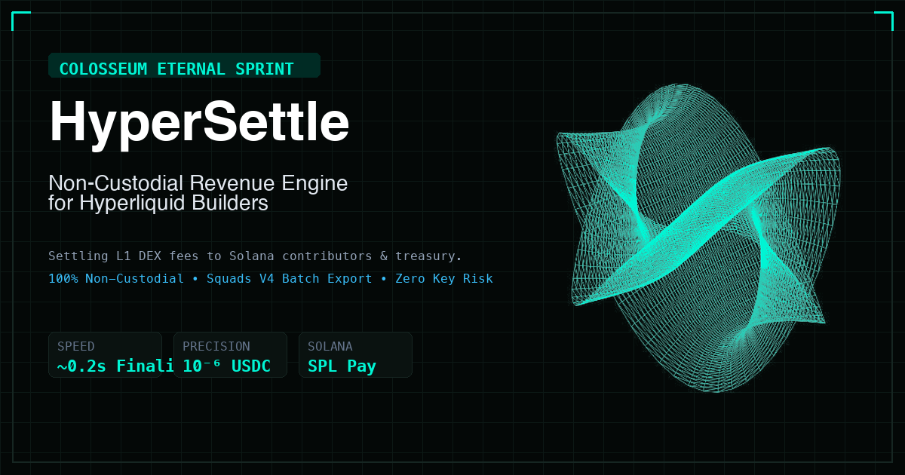

<p align="center">
  
</p>

# HyperSettle ⚡

> **The non-custodial revenue reconciliation and Solana settlement engine for Hyperliquid builder teams.**

Built for **Colosseum Eternal** (Payments & Developer Tooling Track).

<p align="center">
  <a href="branding/official_logo_showcase.html"><b>⭐ Official 4K Logo Suite</b></a> •
  <a href="branding/3d_parametric_studio.html"><b>🎮 3D Parametric Studio (50 Shapes)</b></a> •
  <a href="branding/showcase_scientific_differential_geometry.html"><b>🔬 Scientific 3D Suite</b></a> •
  <a href="branding/showcase_3d_mesh_100.html"><b>📐 100 3D Mesh Logos</b></a> •
  <a href="branding/brand_cards_showcase.html"><b>🎴 Brand Cards</b></a>
</p>

---

## 1. Summary

Over **$65M+** has been distributed to third-party developers and frontends through Hyperliquid’s builder codes. Today, teams running custom frontends, trading terminals, Telegram bots, and market-making strategies manage their builder fee revenue through spreadsheets and manual CSV exports.

**HyperSettle** is an operational and financial management platform for teams earning builder fees on Hyperliquid. It ingests onchain builder fee events from HyperCore, attributes revenue by source (frontend, bot, API), enforces deterministic micro-USD contributor split calculations, reconciles aggregates against raw onchain records, and exports ready-to-execute **Solana USDC batch settlements for Squads multisigs**.

HyperSettle is **100% non-custodial**—it does not hold private keys, manage custody of team treasuries, or execute automated fund transfers on its own.

---

## 2. The Problem

Teams operating builder codes on Hyperliquid need answers to three critical operational questions:

1. **Attribution:** How much did our team earn this period, broken down by individual frontend, bot, or integration channel?
2. **Reconciliation:** Do our internal fee totals match HyperCore's onchain ledger records and claimed referral rewards exactly?
3. **Contributor Splits:** How should revenue be distributed among contributors under agreed rules (percentages or fixed quotas), and can we prove the math with zero rounding discrepancies?

Today, this process is manual, error-prone, and relies on ad-hoc spreadsheets that fail to handle edge cases or verify against raw ledger updates.

---

## 3. Key Features

- **HyperCore Ingestion Worker:** Ingests raw fill events and builder fee records idempotently (`INSERT ... ON CONFLICT DO NOTHING`).
- **Source Attribution:** Categorize fee events by channel (Web Terminal, Telegram Bot, Mobile, Private API).
- **Deterministic Micro-USD Split Engine:** Allocates contributor shares in integer micro-USD ($10^{-6}$, matching native USDC decimals) with deterministic tie-breaking for integer remainder rounding.
- **Onchain Ledger Reconciliation:** Cross-references fill rollups against Hyperliquid's `referral` / `builderRewards` data to flag mismatches or missing fills.
- **Solana & Squads Multisig Settlement Exporter:** 1-click export of settlement distributions formatted for:
  - Standard Auditable CSV.
  - **Squads Multisig Batch Payout CSV** (for teams managing treasuries on Solana).
  - Solana SPL USDC batch transfers.

---

## 4. Architecture

```
[HyperCore Data / WebSocket / QuickNode]
                   │
                   ▼
       [ Ingestion Worker (TS) ]
                   │
         Idempotent Storage
                   ▼
          [ SQLite / Postgres ]
         ├── raw_events
         ├── fee_events
         ├── builder_codes
         ├── contributors (Solana / EVM wallets)
         ├── split_rules
         └── settlements & lines
                   │
                   ├───────────────────────┐
                   ▼                       ▼
           [ Rollup Worker ]     [ Reconciliation Job ]
                   │                       │
                   └───────────┬───────────┘
                               ▼
                       [ REST API Server ]
                               │
                               ▼
                    [ React Dashboard SPA ]
```

---

## 5. Technical Specifications & Verified Constants

- **Builder Fee Format (`f`):** Specified in tenths of a basis point (`decibps`). `1` = 0.001%, `10` = 0.01% (1 bp).
- **Protocol Caps:** 0.1% (10 bps) on Perpetual Futures; 1.0% (100 bps) on Spot Markets.
- **Accounting Denomination:** Integer micro-USD ($10^{-6}$), aligning 1:1 with Hyperliquid's 6-decimal USDC accounting.
- **Finality:** HyperBFT instant deterministic consensus (no probabilistic reorgs; sub-second commitment).
- **Rate Limits:** Shared 1,200 weight points/minute per IP; standard `/info` calls cost 2 points.

---

## 6. Sprint Milestones (Colosseum Eternal)

- **Week 1 (Nov 6 – 12):** HyperCore ingestion pipeline for live builder codes, local SQLite store, manual 1-day reconciliation demo.
- **Week 2 (Nov 13 – 19):** Revenue & attribution REST API, dashboard overview, daily/weekly rollups, automated reconciliation engine.
- **Week 3 (Nov 20 – 26):** Contributor management, split rule logic (percent + fixed), preview/finalize settlement workflow, **Squads Solana batch CSV exporter**.
- **Week 4 (Nov 27 – Dec 4):** Dashboard polish, end-to-end integration tests, pitch deck, technical walkthrough video, and final Colosseum submission.

---

## 7. License

MIT License. Designed and developed for the Colosseum Eternal hackathon sprint.
